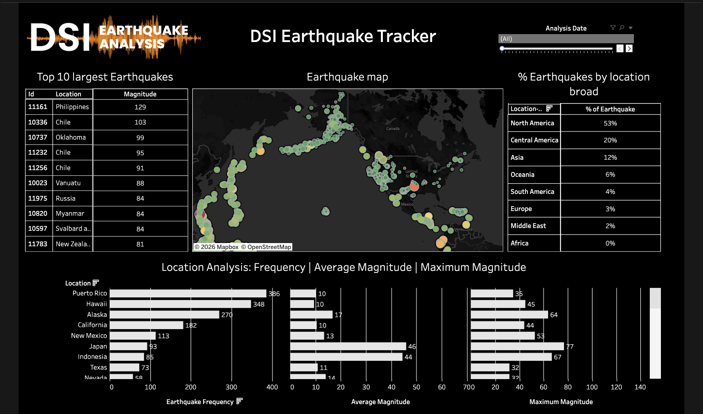

# 🌍 Earthquake Tracking Dashboard (Tableau)

An interactive Tableau dashboard for exploring global earthquake activity over a 30-day period
(11 July – 10 August 2022): where earthquakes happen most, which were the largest, and how
regions compare.

**👉 [View the live dashboard on Tableau Public](https://public.tableau.com/shared/SD2GKZ3JZ)**

## Questions it answers
- Where in the world do earthquakes happen most often?
- Which were the 10 largest earthquakes in the period?
- How do locations compare on frequency, average magnitude and maximum magnitude?

## Data
- **2,228 earthquake records** across **91 locations** in **8 world regions**
- Fields: `id`, `datetime`, `latitude`, `longitude`, `magnitude`, `location`, `location-broad` (region)
- No missing values
- Source: Data Science Infinity course dataset (`earthquake-data.csv`)
- Note: `magnitude` values are on the dataset's own scale (not the Richter value)

## Dashboard: "DSI Earthquake Tracker"
| Sheet | What it shows |
|---|---|
| Earthquake map | Every earthquake plotted by latitude/longitude, sized by magnitude |
| Top 10 largest earthquakes | Ranked table of the biggest events |
| % Earthquakes by location broad | Each region's share of all earthquakes |
| Location chart | Frequency, average magnitude and max magnitude per location |

## Tableau techniques used
- **LOD expression:** `{FIXED [location-broad], [location]: MAX([magnitude])}` to get each location's maximum magnitude regardless of filters
- **Table calculation for Top N:** `INDEX() <= 10` filter for the top 10 largest earthquakes
- **Ratio calculation:** each earthquake's magnitude relative to its location's maximum
- **Counter field** (`Earthquake Counter = 1`) to count events
- Interactive filters and a combined dashboard layout

## Key insights
- **North America accounts for over half of all recorded earthquakes (1,172 of 2,228, about 53%)**, followed by Central America (445, 20%).
- **Puerto Rico (386), Hawaii (348) and Alaska (270)** are the most frequent locations, together about 45% of all events.
- **Frequent ≠ strong:** the largest earthquakes came from places with far fewer events. The single biggest was in the **Philippines on 27 July 2022**, and **Chile** had 3 of the top 5.
- Locations like **Vanuatu, Myanmar and the Philippines** have relatively few events but high average magnitudes, so they would be missed by looking at counts alone.

## Files
| File | Description |
|---|---|
| `dashboard.png` | Screenshot of the dashboard |
| `DSI_Earthquake_Dashboard.twbx` | Tableau packaged workbook (open in Tableau Desktop or Tableau Public) |
| `earthquake-data.csv` | Source data |

## Tools
Tableau Public
